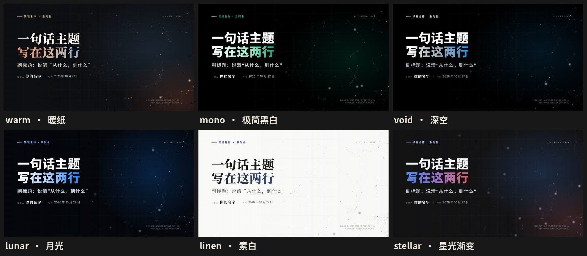
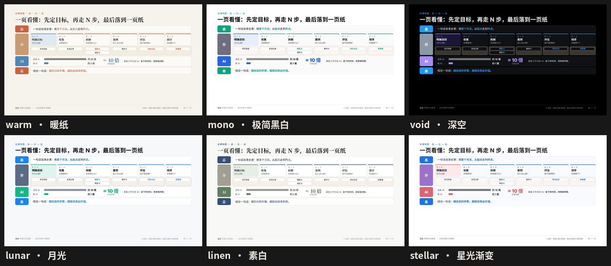
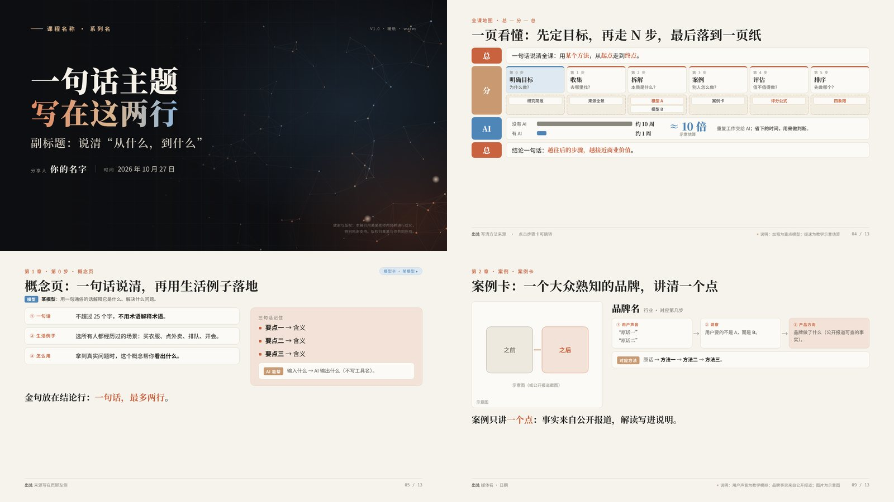
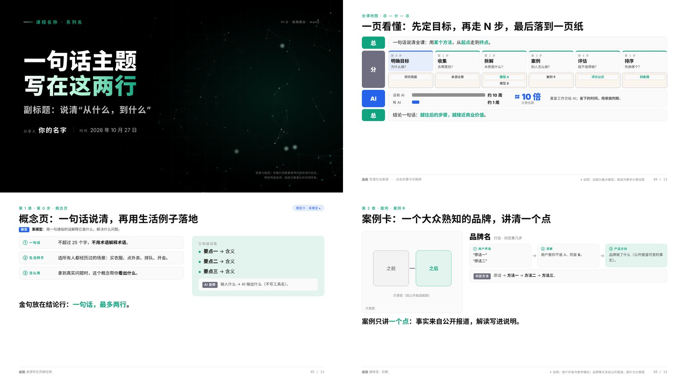
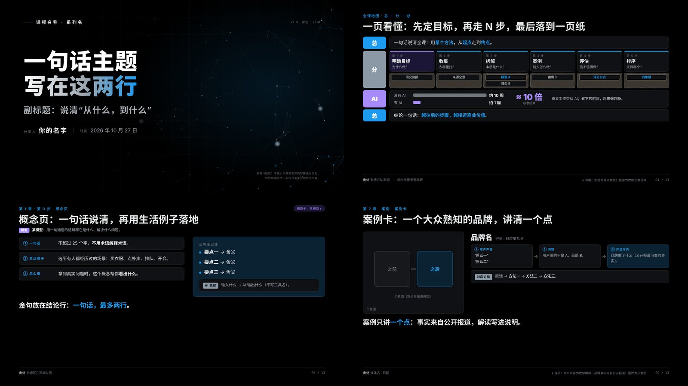
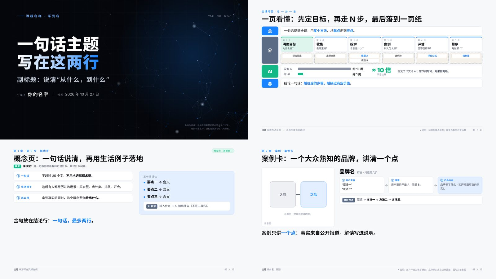
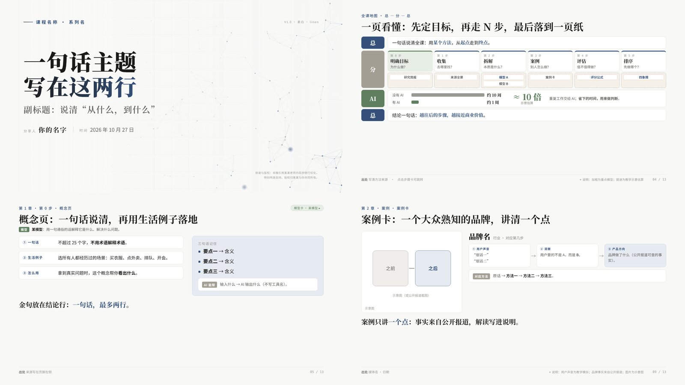
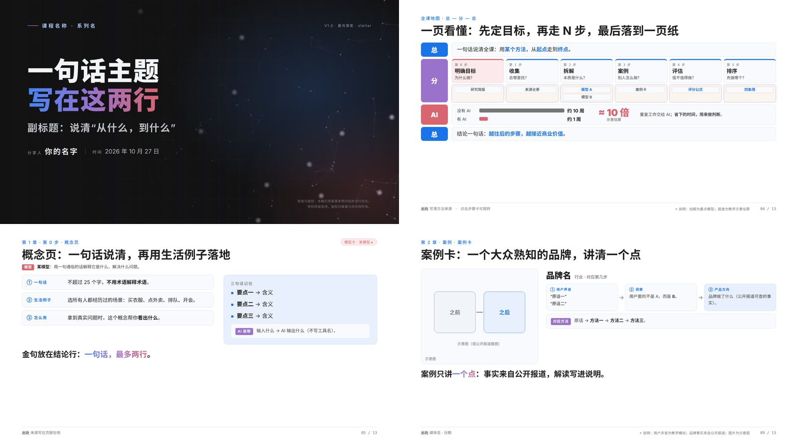

# HTML Deck Kit · 交付级 HTML 演讲稿规范

> 一套**规范 + 母版 + 6 套主题 + AI Skill**。把讲稿交给 AI，按规范生成一个可直接上台、可直接交付的单文件 HTML 演讲稿。
> 人能读，AI 也能照做：Claude、Codex、WorkBuddy、Trae、飞书智能体都能用。



---

## 1. 它解决什么问题

AI 生成的演讲稿常见三个问题：

1. **能看，不能讲**：没有逐字稿，讲师上台不知道每一步说什么。
2. **能讲，不能交付**：内容堆到页面底部，投到大屏后排看不见；换个场合要删页，只能重做。
3. **每次都不一样**：今天一种风格，明天另一种风格，团队没法沉淀。

HTML Deck Kit 用一份**严格规范**把这些固定下来：版面、字号、页面结构、讲稿、交互、案例写法、篇幅分档、主题，全部有明确规则；AI 只需要“照规范填内容”。

## 2. 你会得到什么

| 能力 | 说明 |
|---|---|
| 单文件交付 | 一个 `.html`，双击打开；图片内嵌，无视频，离线可用 |
| 逐字稿 | 每页、每一步都有讲稿；S 键打开讲稿抽屉，P 键演讲者视图（带计时） |
| 逐步弹出 | 只在“先问后答 / 层层深挖 / 案例拆解”时使用，其余一次性展示 |
| 两档篇幅 | 精讲版 / 完整版一键切换（V 键）；模型卡、讲师页默认隐藏 |
| 70% 版面规则 | 内容全部在画面上方 70%，大屏后排也看得见；L 键显示安全线 |
| 字号可调 | + / − 六档放大正文，标题不变；内容满的页面自动停在安全上限 |
| 6 套主题 | T 键切换：warm、mono、void、lunar、linen、stellar |
| 13 种页面模板 | 封面、章节页、总分总地图、概念页、模型卡、表格、拆解、案例卡、计算器、四象限、分级卡…… |
| 自动检查 | `tools/check_layout.py` 逐页检查 70% 规则与讲稿段数 |

## 3. 六套主题

所有主题共用同一组颜色变量（token），组件不写死颜色，所以换主题不需要改任何页面。

| 主题 id | 名称 | 气质 | 主强调色 | 标题字体 |
|---|---|---|---|---|
| `warm`（默认） | 暖纸 | 温暖、学术、像纸质讲义 | `#C9623F` 陶土橙 | 衬线 |
| `mono` | 极简黑白 | 克制、留白、工程感 | `#10A37F` 青绿 | 无衬线 |
| `void` | 深空 | 全深色、科技、高对比 | `#1D9BF0` 亮蓝 | 无衬线 |
| `lunar` | 月光 | 清爽、理性、蓝白 | `#1783FF` 月光蓝 | 无衬线 |
| `linen` | 素白 | 安静、编辑感、浅色封面 | `#34507A` 墨蓝 | 衬线 |
| `stellar` | 星光渐变 | 明亮、渐变、发布会感 | `#1A73E8` → `#9B72CB` → `#D96570` | 无衬线 |

**同一页“总—分—总全课地图”在六套主题下的效果：**



<details><summary>逐个主题看（封面 · 全课地图 · 概念页 · 案例卡）</summary>

**warm · 暖纸**


**mono · 极简黑白**


**void · 深空**


**lunar · 月光**


**linen · 素白**


**stellar · 星光渐变**


</details>

> 主题中不含任何品牌标志或专有字体。

## 4. 快速开始

### 方式 A：直接用模板（不用 AI）

1. 打开 `template/deck-template.html`，看 13 种示例页。
2. 复制需要的 `<section class="slide">`，改文字。
3. 改 `<html data-theme="warm">` 选默认主题。

### 方式 B：交给 AI（推荐）

把整个 `html-deck-kit` 文件夹交给 AI，第一句话：

```
请先阅读 html-deck-kit/SKILL.md 和 references/01-spec.md，严格按规范，
以 template/deck-template.html 为母版，把附件讲稿做成 HTML 演讲稿。
默认主题 warm，精讲 45 页左右。先给我逐页大纲，我确认后再做页面。
```

不同工具的接入方式见 [`references/06-prompts.md`](references/06-prompts.md)。

### 方式 C：安装为 Claude Skill

把 `html-deck-kit` 文件夹（含 `SKILL.md`）放入 Claude 的 Skills 目录或在 Claude.ai 上传为技能。之后直接说“用 deck-kit 做演讲稿”。

## 5. 规范速览（完整版见 `references/01-spec.md`）

```
y=0    ┌──────────────────────────────────────────┐
       │ 眉标：第 N 章 · 第 N 步 · 页面类型（17px）   │
       │ 标题：一句完整的判断（46px，≤ 2 行）         │
       │ 模型：模型名 —— 一句白话（用到模型时必须有） │
       │ 正文：表格 / 卡片 / 图 / 交互               │  ← 上 70%
       │ 结论行：一句话，紧跟正文                    │
y=630  ├ ─ ─ ─ ─ ─ ─ ─ 70% 安全线（L 键） ─ ─ ─ ─ ─ ─┤
       │                                            │  ← 下 30%
       │ 页脚：出处 ·  ● 说明：模拟数据，仅供参考 · 页码 │    只放页脚
y=900  └──────────────────────────────────────────┘
```

**不可违反的 10 条：**

1. 单文件 HTML，1600×900 画布，不改引擎。
2. 正文与结论行全部在 y ≤ 630px；结论行紧跟正文。
3. 标题 46px、眉标 17px 固定；正文 ≥ 18px。
4. 每页有 id、标题、重点、时长和逐字稿；讲稿段数 = 弹出步数 + 1。
5. 默认一次性展示；只有“先问后答 / 层层深挖 / 案例拆解”才逐步弹出，每页 ≤ 4 步。
6. 用到模型的页面必须写出模型名 + 一句白话；模型卡只讲一次，默认隐藏。
7. 概念用三段式：一句话 / 生活例子 / 怎么用。
8. 数字与引语照抄并写出处；模拟数据、示意、解读写进页脚“说明”。
9. 不放视频；不用品牌标志；颜色只用变量。
10. 必须有“总—分—总”全课地图页。

## 6. 快捷键

| 键 | 作用 | 键 | 作用 |
|---|---|---|---|
| → / 空格 | 下一步 | ← | 上一步 |
| G | 目录（可隐藏单页） | S | 逐字稿 |
| P | 演讲者视图 | F | 全屏 |
| **T** | 换主题 | **V** | 精讲 / 完整 |
| **+ / −** | 正文字号 | **L** | 70% 安全线 |
| H | 显示隐藏页 | B | 从模型卡返回 |

## 7. 目录结构

```
html-deck-kit/
├── SKILL.md                    # AI Skill 入口：工作流程 + 10 条硬规则
├── README.md                   # 本文档（给人看，也给 AI 看）
├── references/
│   ├── 01-spec.md              # 严格规范（必须 / 应该 / 可以）
│   ├── 02-components.md        # 13 种页面模板 + 组件类名
│   ├── 03-themes.md            # 6 套主题与 token 表、新增主题规则
│   ├── 04-interaction.md       # 快捷键、讲稿规则、交互约束
│   ├── 05-checklist.md         # 交付检查清单
│   └── 06-prompts.md           # Claude / Codex / WorkBuddy / 飞书 的用法
├── template/deck-template.html # 母版：引擎 + 6 套主题 + 13 种示例页
├── themes/themes.css           # 主题层（与母版内一致，便于单独查看）
├── tools/check_layout.py       # 70% 规则与讲稿检查（Playwright）
└── docs/
    ├── showcase.html           # 主题展示页（本地打开）
    └── img/                    # 预览图
```

## 8. 给 AI 的说明（AI 请从这里开始）

1. 读 `SKILL.md`，然后读 `references/01-spec.md`；其余 reference 按需读。
2. 永远以 `template/deck-template.html` 为母版：只增删 `<section class="slide">`，不改 `<style>` 与 `<script>`（主题 token 除外）。
3. 先输出逐页大纲（页号、id、标题、模板、档位、展示方式），得到确认后再写页面。
4. 写完运行 `python3 tools/check_layout.py <文件>` 与 `--zoom 1.3`，直到没有 `OVER`。
5. 不确定的事实写“材料未注明”；模拟内容在页脚 `.cav` 注明。

## 9. 许可

代码与规范以 [MIT License](LICENSE) 发布。Author: [Gavin Luo](https://github.com/Gavinluo19) · X [@gavinluo19](https://x.com/gavinluo19)。

---

### English summary

**HTML Deck Kit** is a strict specification, a single-file HTML deck template, six color themes, and an AI Skill for building presentation-ready HTML slide decks (1600×900, speaker notes per step, core/full length toggle, hidden "model cards", a 70% layout rule for big screens, adjustable body font size). Give the whole folder to your AI agent and ask it to read `SKILL.md` and `references/01-spec.md` first.
